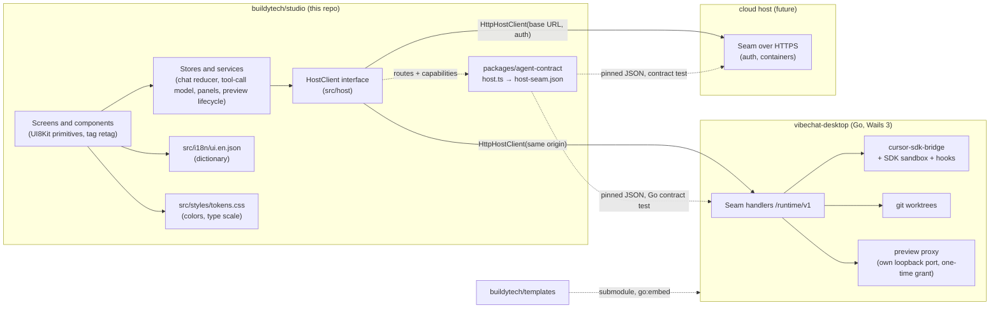

# Architecture — BuildY Studio

The Studio is a SolidJS single-page app. Hosts serve its built files and answer the host seam under `/runtime/v1`
(ADR 0002). It never talks to anything else.

## Layers and their rules

| Layer | Path | May import | Rules |
| --- | --- | --- | --- |
| Screens / components | `apps/studio/src/{Projects,Studio,Settings}.tsx`, `chat/*.tsx`, `studio/**`, `editor/*.tsx` | stores, services, kit, i18n | UI8Kit app layer (ADR 0003): primitives only, ARIA via props, tokens, Lucide, `t()` for words |
| Stores and services | `chat/*.ts`, `chat/tools/*`, `studio/panels/*.ts`, `preview-lifecycle.ts` | `HostClient` (interface), contracts | pure where possible, unit-tested; no DOM |
| Host access | `src/host/` | `@buildy/agent-contract` | the only code that knows URLs; `HttpHostClient` over a `HostTransport` |
| Contracts | `packages/agent-contract`, `packages/studio-panel-contract` | zod | additive only; generated JSON committed |
| Kit | `src/kit` (ui8kit@3, generated) | — | never edited by hand; `ui8kit check` |
| Vendor wrappers | `src/vendor-ui` (markdown, CodeMirror) | third-party | outside the rules zone, ADR 0004 |

## Dependency injection

`createHostClient(config)` returns a `HostClient`. `index.tsx` makes one for the build (desktop: same origin) and
provides it with `HostProvider`; components take it from `useHost()`. Tests pass a fake transport. The legacy
module-level `api` object is that same default client and is removed once every caller uses `useHost()`.

## Data flow of a prompt

1. The composer calls `host.promptAgent(...)`; the host answers 200 (outcome) or 202 (`runId`).
2. The chat opens `host.openAgentEvents(...)`; `readAgentEventStream` parses SSE frames (1 MiB cap) into
   `AgentEvent`s validated by zod.
3. The chat reducer folds messages; `reduceToolEvent` folds tool calls (ADR 0005); the view renders through the tool
   renderer registry.
4. `files.changed` tells the preview panel to reload (HMR covers most edits).

## Where to change what

- New seam route: `packages/agent-contract/src/host.ts` → `bun run gen:host-seam` → a `HostClient` method → the
  host's contract test.
- New tool kind: a renderer in `chat/tools/renderers/` and one `register()` line.
- New words: `src/i18n/ui.en.json`, then `t("key")`.
- New color or type size: `src/styles/tokens.css` only.
